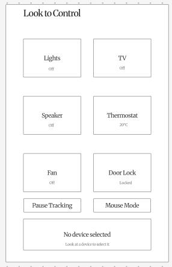
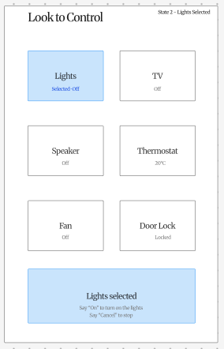
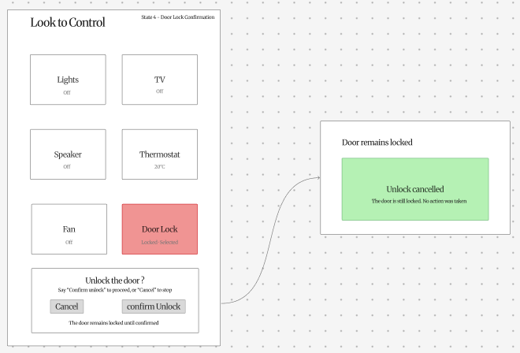

# Early Prototype Testing and Improvements

## Overview

After reviewing the first version, we identified several areas that need improvement, particularly regarding confirmation notices, door lock security, accessibility, and privacy protection.

## 1. Early Usability Review

The initial designs were reviewed the preliminary design from two different user perspectives: one for users who prefer quick and simple interactions, and another for users who are less familiar with eye-tracking controls and require clearer guidance.

The review identified several potential issues:

- User may not understand what to do after selecting a device.
- The door lock confirmation process could be made clearer.
- Visual feedback should be provided when canceling an operation.
- The interface should indicate whether eye-tracking is active.
- Alternative control methods should be provided for users who have difficulty using eye or voice controls.

These points were used to guide the next version of the design.

## 2. Revised State

### Updated state 1

An eye-tracking status indicator has been added to show whether the camera tracking feature is active.

In addition, “Pause Tracking” and “Mouse Mode” options have been added to give users greater control over how they interact with the system.

These changes are designed to improve accessibility, privacy, and user control.

### Updated state 2

The confirmation instructions have been clarified so that users know exactly what to do after selecting a “light” device.

The updated interface provides more specific instructions—for example, simply saying “on” will turn on the light—and includes a new option to cancel the action.

This change is intended to reduce confusion and prevent accidental activation.

### Update state 4

Since unlocking a door is a high-risk operation, we have updated the door lock confirmation instructions.

The interface now explains how users can confirm or cancel this operation and clearly states that the door will remain locked until the user confirms.

This change is intended to enhance security, prevent errors, and give users greater control.

We have designed an additional feedback status to display the result when a user cancels the unlock operation.

This prompt confirms that the operation has been canceled and that the door remains locked.

This makes the outcome of canceling the operation clearer and helps users understand the device’s current status.

## 3. Design Principles

The revised design focuses on the following Human-Computer Interaction (HCI) principles:

- Visibility and Feedback: Selected devices, completed actions, and the results of canceled actions should be clearly displayed.
- Error Prevention: Simply gazing at a device should not immediately trigger that device. High-risk actions require additional confirmation.
- User Control: Users should be able to cancel actions and pause eye tracking.
- Consistency: Device positions and the main layout remain consistent across different screens.
- Accessibility: Mouse-based alternatives are provided for users who may have difficulty using gaze or voice controls.
- Privacy: The interface indicates when eye tracking is active and provides a way to pause the feature.

